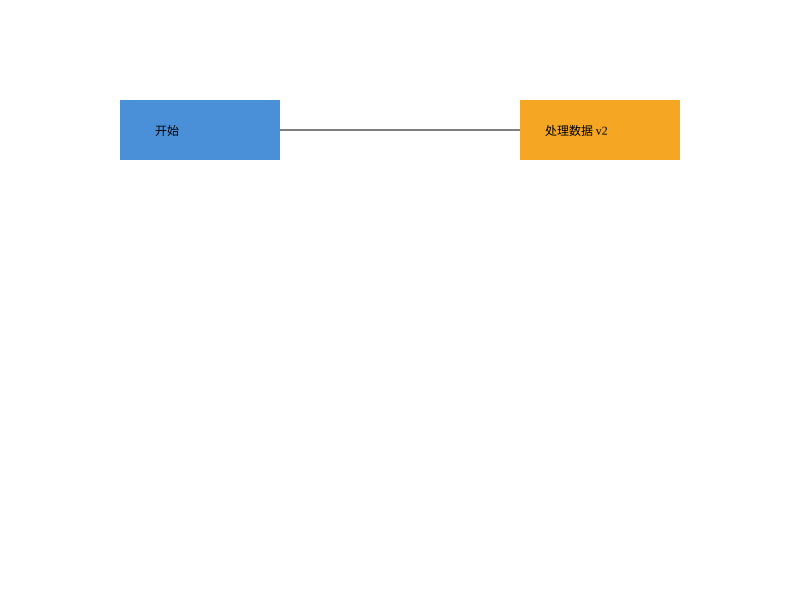

# SVG Editor CLI · Lab1 Phase 1

高级软件开发技术课程作业：使用 TypeScript、Command、Composite 与 Memento 实现可撤销的 SVG 命令行编辑器。

- **公开仓库**：[Monica-Lovelace/svg-editor-cli-phase1](https://github.com/Monica-Lovelace/svg-editor-cli-phase1)
- **最终版本**：[final](https://github.com/Monica-Lovelace/svg-editor-cli-phase1/tree/final)
- **提交报告**：[doc/README.md](doc/README.md)（含仓库地址、架构图、过程记录、自查和质量保证）
- **持续集成**：[GitHub Actions](https://github.com/Monica-Lovelace/svg-editor-cli-phase1/actions)

## 运行

需要 Node.js 22 或更新版本；建议 Node.js 24。锁文件已提交。

```bash
git clone https://github.com/Monica-Lovelace/svg-editor-cli-phase1.git
cd svg-editor-cli-phase1
git checkout final
npm ci
npm run check
npm run cli
```

```text
svg> init 800 600
svg> create g scene
svg> create rect r 10 20 100 50 #4a90d9 in scene
svg> create text t 25 50 "你好 SVG" in scene
svg> move scene 30 10
svg> undo
svg> save demo.svg
```

交互模式使用 `svg>` 提示符，Ctrl-D 结束输入。脚本模式逐行执行，不插入提示符。以 `#` 开头的整行是注释，颜色中的 `#` 保留。带空格参数使用双引号，引用内支持反斜杠转义双引号与反斜杠。

## 示例与检查

```bash
npm run cli < examples/flowchart.commands
npm run cli < examples/session.commands
npm run check
```

第一个示例生成 `examples/flowchart.svg`，可直接用浏览器打开。第二个会话包含题目要求的两条预期错误（祖先/后代分组冲突、save 后禁止 undo），并导入缺 id 示例。



所有必需命令、六种图形、结构编辑、撤销重做和 SVG 读写均已实现。`box` 与动态插件属于后续阶段；导入范围与未明确处的约定见提交报告。
