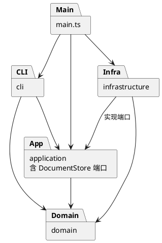

# 高级软件开发技术 · Lab1 Phase 1：SVG 编辑器（CLI）

**Git 仓库地址：[https://github.com/Monica-Lovelace/svg-editor-cli-phase1](https://github.com/Monica-Lovelace/svg-editor-cli-phase1)**

- 最终验收版本：[final 标签](https://github.com/Monica-Lovelace/svg-editor-cli-phase1/tree/final)。
- [开发提交历史](https://github.com/Monica-Lovelace/svg-editor-cli-phase1/commits/main/) · [持续集成结果](https://github.com/Monica-Lovelace/svg-editor-cli-phase1/actions)。
- 本报告对应附件 `phase_cli_1.md`。按补充提交要求，以本 README.md 作为提交文件；代码、测试、示例与图源保存在仓库中。
- 用户确认截止日期为 **2026 年 11 月 30 日**，本项目开发与验收日期为 **2026 年 10 月 26 日**。

## 运行与功能说明

环境：Node.js 22/24；本地验收使用 Node.js 24.18.1、npm 11.16.0。TypeScript 5.9.3、fast-xml-parser 5.11.2 通过 package-lock.json 锁定，使用 `npm ci` 安装。

```bash
git clone https://github.com/Monica-Lovelace/svg-editor-cli-phase1.git
cd svg-editor-cli-phase1
git checkout final
npm ci
npm run check
npm run cli
```

交互入口显示 `svg>`，Ctrl-D 退出。`npm run cli < examples/flowchart.commands` 可回放脚本，非交互模式省略提示符。保存结果可直接由浏览器打开。

| 类别 | 已实现命令 |
|---|---|
| 文档 | `init [w h]`、`read <file.svg>`、`save [file.svg]`、`canvas [w h]` |
| 基本编辑 | `create <type> <id> ... [in <containerId>]`、`delete <id>`、`move <id> <dx> <dy>`、`scale <id> <factor>`、`set <id> <attr> <value>` |
| 结构编辑 | `group <newGid> <id1> [id2 ...]`、`ungroup <gid>`、`addto <gid> <id>`、`front <id>`、`back <id>` |
| 查询与历史 | `tree [id]`、`show <id>`、`help`、`undo`、`redo` |

支持 rect、circle、ellipse、line、text、g 六种类型，`help` 显示各类完整参数。`set` 严格遵守题目白名单，不允许修改 id。错误以 `error:` 开头；失败不改变当前文档、保存路径或历史。

`box` 和动态插件不在第一阶段范围；`create box` 输出规定的未知类型错误。带 `data-kind="box"` 的普通 SVG g 可作为普通容器读入，不恢复插件语义。

## 一、架构方案

### 1.1 模块划分与职责

| 模块 | 主要类/文件 | 职责 |
|---|---|---|
| `src/main.ts` | 装配入口 | 创建存储、会话与 REPL，不包含编辑逻辑 |
| `src/cli/` | Repl、Tokenizer、Arguments、CommandDispatcher、TreeRenderer、ShapeInspector、查询命令 | 输入解析、命令对象构造、终端显示；保留引号信息与空字符串 |
| `src/application/` | EditorSession、HistoryManager、commands、ports/DocumentStore | 编排操作，管理路径与历史屏障，封装命令，定义存储接口 |
| `src/domain/` | SvgDocument、ShapeFactory、DocumentMemento、Numeric、EditorError、shapes | 图形行为，数值与结构约束，唯一 id，父级索引，快照 |
| `src/infrastructure/` | NodeDocumentStore、SvgReader、SvgWriter、XmlElement、SvgTransform | 文件系统、XML 适配、受限 transform 导入、错误映射 |
| `tests/`、`scripts/` | 四个测试文件、内存存储替身、架构检查脚本 | 功能验收、依赖和类文件名检查、分派风险检查 |
| `examples/`、`doc/` | 命令脚本、示例 SVG、报告、PlantUML 源与渲染图 | 演示与设计依据 |


[PlantUML 源文件](https://github.com/Monica-Lovelace/svg-editor-cli-phase1/blob/final/doc/architecture.puml)。箭头表示源码依赖，不表示运行数据流；图为 PlantUML 包图。以下为可独立复现的简化图源：



### 1.2 设计模式及落地

**Command（必需模式）**：每条编辑指令对应独立命令类，例如 MoveCommand、GroupCommand、DeleteCommand。命令保存目标 id 和参数，经 `execute(session)` 执行；UndoableCommand 提供事务与 undo/redo 的通用流程，HistoryManager 管理两个命令栈。分组涉及多个节点仍只记录一个命令对象。

**Composite**：Shape 为统一抽象；Rect、Circle、Ellipse、Line、Text 是叶子，Group 也是 Shape。叶子通过 GeometryShape 封装几何验证和变换；Group 把 move/scale 递归给子节点，调用方不按 tag 区分类型。公共样式由 Shape 管理，Text 重写文本属性行为。删除在 SvgDocument 中操作统一 Shape 子树和索引。

**Memento**：DocumentMemento 持有私有深复制文档，恢复时再次克隆，不暴露内部状态。UndoableCommand 在独立候选副本上编辑和验证，成功后才提交并记录前后快照，失败丢弃候选副本。undo/redo 恢复父级、兄弟顺序、子孙与数值，不通过反向缩放积累误差。

**工厂与适配边界**：ShapeFactory 的单个内置目录同时服务 CLI 创建与 XML 导入。DocumentStore 是应用层端口，NodeDocumentStore 实现磁盘读写，测试使用 MemoryDocumentStore。SvgWriter 消费模型的只读 `attributes/children/textContent/type` 投影，不按图形类型再分派，领域模型不引用 XML 库。

按名字选择图形类或命令实现只集中在两处：

1. `src/cli/CommandDispatcher.ts`：命令名 → 命令构造器。
2. `src/domain/ShapeFactory.ts`：图形类型名 → 几何 schema 与构造器；CLI 与 SVG 导入共用。

**待重构项**：两处仍是内置清单，后续插件阶段再改为外部注册机制。本阶段不引入动态加载、插件所有权或 box 模板。XML 根节点识别、属性白名单和 transform 语法解析不承担图形类型/编辑命令实现分派。

### 1.3 依赖方向规则

| 模块 | 允许依赖 | 禁止依赖 | 理由 |
|---|---|---|---|
| domain | domain 内部 | application、cli、infrastructure、Node API、第三方库 | 模型可独立运行与验证 |
| application | application、domain | cli、infrastructure、Node API、第三方库 | 经自身存储端口使用 IO |
| cli | cli、application、domain、必要 Node 终端 API | infrastructure | 具体存储由 main 注入 |
| infrastructure | infrastructure、application 端口、domain、Node/XML 库 | cli | 负责适配，不控制显示或历史 |
| main | 上述各层 | 不承担业务逻辑 | 唯一组合根 |

查询渲染器可以读模型，编辑必须经过命令。几何、样式、子节点集合、索引和快照使用私有字段，属性投影和 children 返回只读副本，模型具有实际行为。

### 1.4 核心状态与语义

文档维护有序图形树、id 索引和父级索引。结构操作后重建并核对索引，拒绝重复 id、共享子节点与环。导入先扫描全部显式 id，再补缺失 id，避免碰撞文件后面的名称；警告只在整个 read 成功后输出。

`scale` 将叶子全部几何属性乘 factor，包括位置；Group 递归，不另存可编辑 transform。`set g fill` 使用 SVG 继承，不覆盖子节点的显式 fill。`front` 移到同级数组末尾，`back` 移到开头。

成功编辑产生一个历史单元并清空 redo，失败编辑不清空 redo。成功的 init/read/save/画布修改清空历史并建立禁用屏障，undo/redo 输出 `error: undo not allowed after io command`，直到下一条成功编辑。tree/show/help/canvas 查询不进入历史。

read 验证全部候选模型后才替换当前文档。save 先序列化，再写同目录临时文件，成功 rename 替换目标；失败清理临时文件，不改变会话路径和历史。显式不可写文件、目录和符号链接不作为可覆盖普通文件。

### 1.5 未明确处采用的约定与 SVG 边界

以下为实现约定，不宣称附件已规定，也尚未经过教师额外确认：

| 问题 | 当前规则 |
|---|---|
| group 的目标父级 | 同父级保留原父级；跨父级放在最近公共祖先下，插在最早涉及的直接分支前；组内按修改前文档先序保持相对顺序 |
| 结构变化的样式继承 | 使用新 SVG 树的继承语义，不烘焙原父级样式，分组/取消分组可能影响继承效果 |
| 不完整参数 | init/canvas 接受零个或两个尺寸参数；group 至少一个图形，重复目标拒绝 |
| 默认路径 | 成功 read 或显式 save 建立路径，init 清空；无路径 save 报错 |
| 无文档 help | 允许 help，其他需要文档的命令按规定报错 |
| 数值边界 | 坐标可负，尺寸/半径/描边非负，画布与 scale 为正；拒绝 NaN、Infinity 和溢出 |
| 屏障后的旧历史 | 清空，后续编辑不能撤销回旧文档 |
| undo/redo 成功反馈 | `undone:` / `redone:` 加操作摘要；不逐字复制示例措辞 |

支持六类型、嵌套 g、XML 转义、中文/emoji、注释、CDATA、缺省样式，以及常见字体/透明度/描边展示属性的读回保留；CLI set 白名单保持题目范围。根画布接受数值或 px 宽高，viewBox 需为 `0 0 width height`。

支持背景示例中的 translate 和正向等比 scale，含嵌套及组合顺序。导入时烘焙为实际坐标，同时处理继承的描边宽度、字体大小与虚线长度；保存不保留原 transform 写法。

对 path、defs、style/CSS、tspan、旋转、非等比缩放、百分比几何、不同范围 viewBox、DOCTYPE 等超出范围特性明确报错，不静默删除。本实现是六类型编辑器，未承诺完整 SVG 标准。

### 1.6 变化点假设

| 预计变化 | 已留边界 | 本阶段不做及理由 |
|---|---|---|
| 新类型或 box 插件 | Shape 多态、集中工厂、普通子树 | 不承诺零内核修改；传播语义和插件所有权留待后续 |
| GUI/agent 输入 | 可脱离 REPL 的 Command 与 EditorSession | 不做 GUI、渲染器、agent 协议，避免超范围 |
| 替换存储 | DocumentStore 端口 | 无当前数据库或云存储需求 |
| 更多 SVG 语法 | Reader/Writer/XmlElement/Transform 隔离 | 不在领域层提前建立完整 CSS 系统 |
| 大文档历史 | HistoryManager 与 Memento 分离 | 当前完整快照，单次 O(S)，H 条约 O(H×S) 内存；课程规模优先正确性 |
| 查询格式变化 | TreeRenderer、ShapeInspector | 暂不增加其他输出协议 |

## 二、过程记录

本节记录本次实际协作：用户提供作业、委托实施，并确认提交形式、公开仓库与截止日期；代码、测试和自查由 AI 智能体协助完成。不把 AI 自查写成学生独立发现，不虚构教师确认。

| 阶段/证据 | 讨论或实际发现 | 决定、修正与验证 |
|---|---|---|
| 需求分析 | box 完整示例容易被当成本阶段需求 | 依据阶段边界只实现六类型，测试 box 未知类型错误 |
| `0642485` 工程初稿 | 必须分步 Git，不能最后一次提交全部代码 | 从配置和架构草案开始提交，之后按模型、命令、持久化、测试和文档推进 |
| `27f4765` 领域模型 | 公开数据袋与各处 switch tag 违反范式 | 建立 Shape/GeometryShape/Group 层次，模型维护状态；首批四项测试通过 |
| `5a33c94` 命令历史 | 反向变换无法统一恢复删除、归属和顺序 | Command + Memento，在候选副本操作；验证失败保留 redo、部分递归修改回滚 |
| `72c9de3` SVG 读写 | 缺 id 可能撞上后面的显式名称，按标签归类会破坏层叠顺序 | 双遍预留 id、使用 preserveOrder，增加往返与真实进程回放测试 |
| 方案修订 | 初稿考虑 Visitor、跨来源 group 固定挂根 | 改用通用只读投影，省略 Visitor；group 改为最近公共祖先，配套恢复测试并修订文档 |
| `f8f9880` 架构检查 | 实际安装的 TypeScript 7 默认入口只导出版本信息，AST 脚本报 ScriptTarget 未定义 | 检查包导出，锁定兼容 TypeScript 5.9.3，重新通过构建、测试和架构检查 |
| `f8f9880` SVG 自查 | 烘焙 scale 仍可能遗漏虚线长度，根额外文本不应静默丢弃 | 补 stroke-dasharray 缩放及根文本拒绝，新增回归测试 |
| 运行验收 | 测试通过仍需确认实际终端与浏览器效果 | PTY 验证提示符、嵌套移动与 undo；Chrome 查看两节点 SVG，确认中文与连线位置 |

判断依据来自附件、类型检查、案例、状态恢复断言、依赖检查和独立 CI。后续学生自行修改或收到教师澄清，应追加真实修订记录。

## 三、一致性自查

### 3.1 模块划分

最终使用 main、cli、application、domain、infrastructure 五部分。源代码共 **49 个 TypeScript 文件、46 个类**，其余为接口/端口及入口。每类一个同名文件，严格编译通过。

初稿差异已修订：省略 Visitor，增加 GeometryShape、XmlElement 和 SvgTransform；查询命令放在 cli/commands，文档/编辑/历史命令放在 application/commands。实际目录与本报告最终方案一致。

### 3.2 依赖方向

`npm run check:architecture` 用 TypeScript AST 检查 **142 条 import**，覆盖层间依赖、核心层外部依赖、一类一文件、类名文件名，以及 switch/类型比较风险，当前通过。

代码抽查：

- SvgDocument 只依赖领域内 Shape、Group、Numeric、EditorError。
- UndoableCommand 通过会话与快照完成事务，不引用具体磁盘存储。
- NodeDocumentStore 实现应用层端口，使用 Reader/Writer。
- Repl 使用会话和分发器，由 main 注入存储。
- Reader 复用 ShapeFactory；Writer 使用多态投影，无图形 tag 分支。

两处分派目录已登记为后续重构项，未发现其他违反当前规则的源码依赖。静态检查只是辅助，不能自动证明所有设计语义正确，因此同时保留代码抽查。

## 四、质量保证手段

### 4.1 自动化结果

`npm run check` 先严格编译，再运行 **22 项测试，22 通过、0 失败、0 跳过**，最后执行架构检查。

| 文件 | 项数 | 内容 |
|---|---:|---|
| `tests/domain.test.ts` | 4 | 六类多态、快照独立、嵌套变换、索引、顺序、防环 |
| `tests/commands.test.ts` | 8 | 词法、create in、白名单、编辑、精确 undo/redo、失败原子性、屏障和路径 |
| `tests/svg.test.ts` | 8 | 外部 SVG、id 碰撞、文本/实体/CDATA、变换与继承、拒绝未知特性、磁盘错误 |
| `tests/integration.test.ts` | 2 | 启动真实 CLI，回放完整会话与两节点流程图，检查保存文件 |

测试不仅匹配输出，还比较属性、整树、父级/顺序、历史可用性与路径。递归 scale 溢出用例先改变候选副本的部分节点再失败，用于验证原文档未部分提交。连续结构编辑逐步 undo 到每个旧树，再 redo 到每个新树。

GitHub Actions 在 Ubuntu 的 **Node.js 22、24** 分别执行 `npm ci` 和 `npm run check`，均通过。[首轮完整 CI 证据](https://github.com/Monica-Lovelace/svg-editor-cli-phase1/actions/runs/40264660263)。最终提交状态见仓库 Actions；本报告未虚构覆盖率百分比。

### 4.2 场景与预览

```bash
npm run cli < examples/flowchart.commands
npm run cli < examples/session.commands
```

流程图保存 8 个元素，节点移动后 undo 恢复 y，修改后文字“处理数据 v2”可读回。普通会话保存 5 个元素，祖先/后代 group 与 save 后 undo 输出规定错误；导入 other.svg 得 7 个元素，只输出一条补 id 警告。


已在 Chrome 实际打开此 SVG，确认两个矩形、中文与连线。另以交互终端执行 init/create/move/undo/tree，验证 `svg>` 和恢复后的坐标。预览是自动测试的补充。

### 4.3 Git 与交付

保留初始化、模型、命令历史、持久化、回归和文档等真实阶段提交并推送公开仓库。最终验证后打 `final` 标签固定验收版本，不随意移动到后续代码。

按要求上传本 README.md；同版报告保存在 `doc/README.md`。代码、锁文件、测试、示例、PlantUML 源和架构 SVG、CI 配置均在仓库中。本文件使用公开链接，单独提交仍能访问图与代码。

### 4.4 当前限制

完整快照随历史和文档大小增加内存，未做差量优化。SVG 支持显式子集，范围见 1.5。需求空白采用已登记约定，未收到教师进一步确认。后续插件目标未提前实现。

## 技术资料

- [TypeScript 类与抽象类](https://www.typescriptlang.org/docs/handbook/2/classes)
- [Node.js Readline](https://nodejs.org/api/readline.html) · [Node.js Test runner](https://nodejs.org/api/test.html)
- [fast-xml-parser 官方仓库](https://github.com/NaturalIntelligence/fast-xml-parser)
- [W3C SVG Rendering Model](https://www.w3.org/TR/SVG2/render.html)
